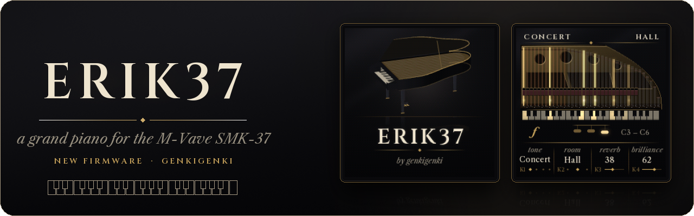
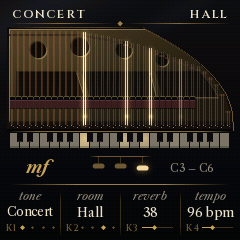

# Erik37

A grand piano for the M-Vave SMK-37 (and the FM-1): a sampled concert grand with velocity layers, a key-by-key decay, dampers and
their noise, the three pedals, sympathetic string resonance and four rooms. It is its own firmware, built on
[fm1-base](https://github.com/charlesvestal/fm1-base) and [felucca-bsp](https://github.com/hugelton/felucca-bsp).

**Status: 1.1, experimental.** Played on an SMK-37 Pro. The FM-1 build is untested on a unit: feedback welcome.
Video: https://youtu.be/5yUCB1-OJNE

Install it with the installer at <https://genkigenki.github.io/smk37/> (Chrome or Edge), the keyboard on USB.
There is one package per model: SMK-37 Pro (and the Starrykey 37 Play), SMK-37 Elite, MKE-P37 and the FM-1
(`erik37-fm1.fwsc`). M-Vave's updater takes the stock firmware back at any time.



## Playing

| Control | What it does |
| --- | --- |
| Keys | the piano, with velocity through the touch curve (TONE & TOUCH); C3..C6, OCTAVE- / OCTAVE+ move them by octaves |
| K1..K4 | the four knobs at the bottom of the screen (below) |
| K5 MASTER | the volume |
| K6..K8 | nothing |
| < / > | the pages: play, TONE & TOUCH, ROOM, ABOUT |
| PATCH | back to the play screen; held, the audio load and the voices in the header |
| Pads 1-4 | the voices: CONCERT (hall), STUDIO (chamber, brighter), VINTAGE (darker), JAZZ (a small room) |
| Pads 5-16 | the user presets USER 1-12: a tap recalls one; held a second, the sound is saved there ("SAVED USER n") |
| PEDAL jack | sustain; a continuous pedal gives half pedal. Plug it in before switching on: its rest position is learnt then |
| SEQ REC | sustain |
| CHORD | sostenuto |
| SCALE | una corda (its depth on TONE & TOUCH) |
| Mod wheel | sustain, with half pedal: off at rest and a little above, full near the top |
| Pitch wheel | pitch bend, +-2 semitones; in tune at rest |
| SEQ PLAY | the metronome (its tempo: K4 on the play screen) |
| BT | save the settings now (they also save themselves once the piano is quiet) |
| FX | every note let go |
| Faders | nothing (every setting is on a knob) |
| USB-MIDI | the keys, pedals and pitch wheel go out (notes, CC 64 / 66 / 67, pitch bend); notes, those pedals and pitch bend come in and play the piano |
| OCTAVE- + OCTAVE+ held 5 s | update mode |

The pedal buttons: held, the pedal is down while held; a tap latches it (its light on) until the next tap. The
sustain is the strongest of the PEDAL jack, SEQ REC, the mod wheel and MIDI.

| Page | K1 | K2 | K3 | K4 |
| --- | --- | --- | --- | --- |
| play | tone | room | reverb | tempo |
| TONE & TOUCH | touch curve | brilliance | resonance (down past 0: off) | una corda depth |
| ROOM | room | size | amount | width |
| ABOUT | audio load | voices | most voices | xruns |

The play screen is a view into the piano: the strings light up as they sound, the dampers lift. A user preset
keeps the tone, room, size, amount, width, brilliance, resonance, touch curve and una corda depth; the presets
survive power-off (in the firmware's own store). The pad lights: a voice dim amber, the one chosen bright gold; a
preset dark when empty, dim warm grey when filled, warm ivory when chosen.

### On the FM-1

`erik37-fm1.fwsc` (identity FM-1_480101) is the same piano for the FM-1's 27 keys (F3..G5, velocity from the keys).
**Untested on a unit.** Its controls:

| FM-1 | What it does |
| --- | --- |
| KNOB 1..4 | the page's four knobs (as K1..K4 above) |
| SELECT | the pages |
| ALGORITHM | the voices CONCERT, STUDIO, VINTAGE, JAZZ |
| PRESETS | the user presets USER 1-12, recalled as it lands on them |
| SAVE | tap: save the settings; held a second: the sound into the user preset PRESETS points at |
| REC / ENV / SEL | sustain / sostenuto / una corda (held or latched) |
| PLAY, FX, HOME, OCT | as SEQ PLAY, FX, PATCH and OCTAVE on the SMK-37; MASTER the volume |

## The sound

- The Salamander Grand Piano V3 (a Yamaha C5): 18 notes across the keyboard in 3 velocity layers, crossfaded in the
  attack, about 380 KB of block-ADPCM samples (4.25 bits a sample, 22.05 to 32 kHz), looped after the attack.
- Each key's decay is measured from the recording (a fast first decay, then the aftersound), faster in the treble.
  The top keys have no dampers, as on a grand.
- The brightness follows the velocity and darkens as a note rings. Releasing a key brings the damper down, with its
  noise.
- Sustain with half pedal, sostenuto, una corda (softer and darker, its depth set on TONE & TOUCH).
- Sympathetic resonance: undamped strings ring along while the sustain pedal is down.
- Tones: CONCERT (as recorded), STUDIO (closer, brighter), VINTAGE (darker, the unisons a little apart), JAZZ
  (round, warm). Rooms: an 8-line FDN reverb, as chamber, hall or church, with a size knob.
- Polyphony: 20 notes, plus room for the ones fading out. The quietest released notes give way first.
- The pitch wheel bends every string (the damper noises stay put), +-2 semitones.
- The phase 1 study (the sample sources, the demos, the engine's prototype) is in `SOURCES.md`, `LISTEN.md` and
  `tools/`.

## Building

On Linux or WSL with JieLi's toolchain (`base/tools/get_toolchain.sh`), the AC79 SDK (for the package's SDK files)
and Python 3 with Pillow and NumPy:

```sh
git clone --recursive https://github.com/genkigenki/erik37
./build.sh                          # the four packages into build/erik37/ (and SHA256SUMS), the host simulators
app/tests/run_tests.sh              # the engine, the CPU budget, the flash, the loader, the packages, the screens
app/build/smk37/host/erik37-smk37_host app/tests/screens.txt /tmp/shots   # the simulator: a script, screenshots
app/build/host/erik37_host app/tests/screens-fm1.txt /tmp/shots-fm1       # the FM-1's
```

`base/` is [fm1-base](https://github.com/charlesvestal/fm1-base) (Charles Vestal, MPL-2.0) with [felucca-bsp](https://github.com/hugelton/felucca-bsp) in `base/bsp` (Leo Kuroshita, MPL-2.0), included here with their SMK-37 board support and two additions for the SMK-37: the keybed's velocity and the PEDAL jack
(`plat_keybed_vel`, `plat_pedal_raw`).

## Licence

MPL-2.0. The piano samples are the Salamander Grand Piano V3 by Alexander Holm, CC BY 3.0. See `LICENSING.md`.
