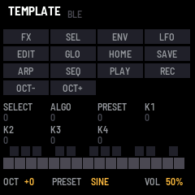
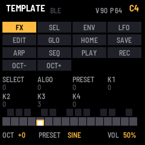
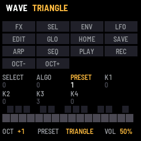

# TEMPLATE

TEMPLATE is the smallest complete firmware for the M-VAVE FM-1, made to be copied. Every control shows on the
screen by its name as you use it, the keys play a simple voice with velocity and pressure, and a few controls do
something: the octave, the wave, the volume and saving. MIDI goes out over USB and Bluetooth. It installs, updates, runs in the browser and speaks to a screen reader, as a finished
firmware does.

This manual is also an example: copy it with the template and write your firmware's own.

---

## Contents

1. Install
2. The screen
3. Controls
4. Saving
5. MIDI and audio
6. The screen reader
7. Troubleshooting

---

## 1. Install

**Try it first:** the emulator runs the same code in the browser, with sound, played with the mouse, a touch
screen or the computer keyboard.

**Install from the browser:** in Chrome or Edge, connect the FM-1 by USB, open the installer and press Install.
The browser asks once to allow MIDI: allow it. Don't unplug the cable while it writes.

**Install from a terminal:** `python3 tools/fm1_install.py template-VERSION.fwsc`.

**Back to the stock firmware:** the installer's last section writes M-VAVE's own firmware back. An FM-1 that
doesn't start can be recovered too. For details, see felucca-bsp's `tools/fm1_rescue.sh`.

---

## 2. The screen

| Part | What it shows |
| --- | --- |
| Header | The name, and BLE: lit while a computer or tablet is connected over Bluetooth. While a key plays, its note, the velocity it landed at (V) and how hard it's pressed (P). A message for a moment after a change. |
| Buttons | All 14, by their names. A button lights while it's held. |
| Knobs | The seven encoders, each with a count of its turns. A knob lights for a moment as it turns. |
| Keys | The 27 keys, black above white. A held key fills to its velocity, and white over that shows its pressure. |
| Bottom line | The octave, the wave (on PRESET) and the volume (MASTER). |

---

## 3. Controls

| Control | What it does |
| --- | --- |
| Keys | Play the voice, louder the harder they land, and send the note over USB and Bluetooth on channel 1, with its velocity. Pressing a held key harder sends aftertouch. The last key pressed sounds. |
| OCT− · OCT+ | The octave, from −2 to +2. |
| PRESET | The wave: sine or triangle. |
| MASTER | The volume. |
| SAVE | Saves the octave, the wave and Bluetooth on or off. SAVE lights while there's something to save. |
| REC | Press: find and connect a Bluetooth MIDI device. Hold a second: Bluetooth off or on. For details, see MIDI and audio. |
| Every other button and knob | Shows its name on the screen, and nothing else. This is where a firmware wires its own. |

---

## 4. Saving

Press SAVE to keep the octave, the wave and whether Bluetooth is on. They come back the next time the FM-1 starts. SAVE stays lit while
there are changes to save.

---

## 5. MIDI and audio

MIDI comes in over USB, Bluetooth and the TRS jack. A note on any channel plays the voice; a note off releases it.
The keys send notes, with their velocity, and poly aftertouch out over USB and Bluetooth.

Over Bluetooth, TEMPLATE advertises as "FM-1". On a Mac, open Audio MIDI Setup, choose Window > Show MIDI Studio,
click the Bluetooth button, then Connect next to FM-1. On an iPad or iPhone, connect from a music app's Bluetooth
MIDI settings.

To switch Bluetooth off, hold REC for a second: the screen says BLUETOOTH OFF, and the FM-1 stops advertising
and drops any connection. Hold REC again to switch it back on. Press SAVE to keep the choice: it stays so the next
time the FM-1 starts.

To connect TEMPLATE to a Bluetooth MIDI device, such as a keyboard or a controller, put the device in its pairing or
advertising mode, then press REC: the screen says BLE SCANNING. Turn ALGORITHM to pick the device by its name, and
press REC again to connect. DEV in the header lights while it's connected, and the bottom line shows the last
message it sent. Press REC once more to disconnect.

The keys sense how hard they're played, with no change to the FM-1. The 20 lowest keys
(F3 to C5) give velocity and pressure; the top seven give velocity only.

Over the USB cable the FM-1 is also a sound card. A computer can record what it plays (an input named
"TEMPLATE FM-1"), and can play through it: choose "TEMPLATE FM-1" as the output, and its sound comes out of the
FM-1's speaker and headphones, mixed with the FM-1's own, at MASTER's volume.

---

## 6. The screen reader

TEMPLATE tells a screen reader what's on its screen, through the
[FM-1 Screen Reader](https://charlesvestal.github.io/fm1-reader/): the name and the settings when the reader
starts listening, then each change as it happens. The emulator does the same, with your own screen reader or
with its built-in voice.

---

## 7. Troubleshooting

**No sound:** turn MASTER up. The voice plays only while a key is held.

**The installer doesn't find the FM-1:** use Chrome or Edge, allow MIDI when asked, and close other programs
that use the FM-1's MIDI port.

**The FM-1 doesn't start after an install:** after two failed starts it waits in the chip's update mode. Put
the stock firmware back, then install again. For details, see felucca-bsp's `tools/fm1_rescue.sh`.
